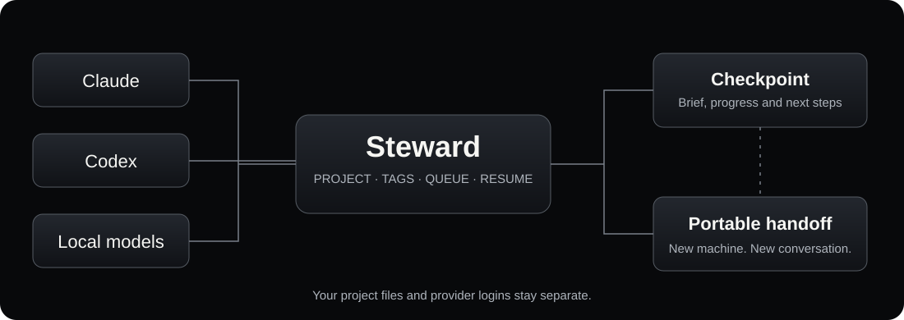

# Steward

[](https://github.com/cmills-dev/steward/actions/workflows/test.yml)
[](LICENSE)
[](https://www.python.org/)

**Keep AI work moving across sessions, projects and computers.**

Steward runs coding agents, saves readable checkpoints, queues continuations and reports failures. Use Claude Code, Codex, or local models through Codex's Ollama and LM Studio backends. Each task keeps its provider, project and tags.

Python 3.9+, standard library only. Host targets are Windows, macOS and Linux. This is a command-line tool. It does not require Cam's vault, dashboard, accounts or paths.



## Download and install

Download `steward-0.2.0.zip` and `SHA256SUMS` from [Releases](https://github.com/cmills-dev/steward/releases). Extract the ZIP, then run the installer inside its folder:

```sh
# macOS or Linux
python3 install.py
# Optional: python3 install.py --prefix "/path/with spaces/tools"
```

```powershell
# Windows, in PowerShell
py -3 install.py
# Optional: py -3 install.py --prefix "$HOME\tools"
```

The default prefix is `~/.local`. Add its `bin` directory to PATH, or use the printed command path. Windows installs `steward.cmd`. PowerShell needs `& "C:\path\bin\steward.cmd"` when the command path contains spaces.

```sh
steward init
steward demo
steward doctor
```

The demo uses a fake CLI, makes no model call and removes its temporary files. `doctor` checks paths and local executables. It does not check account authentication, model capability or server availability.

The installer copies a versioned runtime into `<prefix>/share/steward/0.2.0`. You can then move or remove the extracted download. It records the Python executable used at installation, so reinstall if that interpreter moves. Reinstalling the same version into the same prefix is refused. Choose another prefix for a second copy.

## Choose a provider

| Provider | Requirements | Model selection |
|---|---|---|
| `claude` | Claude Code CLI, signed in separately | `--model`, otherwise the CLI default |
| `codex` | Codex CLI, signed in separately | `--model`, otherwise `STEWARD_CODEX_MODEL` or `gpt-6.1-sol` |
| `local` | Codex CLI plus a running Ollama or LM Studio server | Explicit installed model name required |

Steward does not create accounts, copy logins or download models. A local model must support the tool use needed by Codex. A small chat model may start but fail to complete coding work. Test your chosen model on a disposable project first.

Run a brief in an existing project:

```sh
steward run --id review-api --provider codex --brief brief.md --repo ./my-project --project api --tag review --tag backend --max-minutes 30
steward status --project api --tag review
steward report review-api
steward logs review-api --follow
```

For Claude, use `--provider claude --model sonnet`. For a local model, use `--provider local --model YOUR_INSTALLED_MODEL`. Set `STEWARD_LOCAL_PROVIDER=ollama` or `lmstudio` in `~/.steward/.env`. The selected engine is saved with a started task.

A brief describes the goal, allowed changes and verification steps. Steward adds the checkpoint path. Agents should keep that checkpoint current. A zero exit code without a changed checkpoint is reported as `no-op`.

## Resume and transfer

```sh
steward pause review-api
steward resume review-api
# Continue an already completed task explicitly:
steward resume review-api --force
```

On the same computer, resume uses the saved native conversation and provider. Changing the default provider does not change existing tasks. Provider-specific model fallbacks never move a task from Claude to Codex.

To continue on another computer or OS, first pause the task and wait until it stops:

```sh
steward export review-api --output review-api.zip
# On the destination, with project files already copied or checked out:
steward import review-api.zip --id review-api --repo ./my-project
steward resume review-api
```

A transfer includes the brief, checkpoint, optional notes, tags and provider selection. The destination starts a **new native conversation** from that checkpoint. Project files, uncommitted edits, credentials, logs and native conversation stores are excluded. Copy or commit the project separately and authenticate the destination CLI yourself. Review the bundle before running it. Its hashes detect damage, not a malicious author.

Use one local state directory per machine. This release has no shared distributed queue, automatic project synchronisation, device discovery or migration of provider-native histories. Tags help organise tasks. They do not schedule them across computers.

## Schedule work

```sh
steward queue add --at tonight --title "Review API" --file brief.md --provider codex --repo ./my-project --project api --tag review
steward queue list
steward queue tick --dry-run
steward watch
```

`tonight` means the next 03:30 on the configured clock. `--at +2h`, `--at 14:30`, `--at now` and ISO timestamps also work. Use an explicit UTC offset for deadlines across time zones. Windows installations without IANA time-zone data use the machine clock. Named zones require an available system time-zone database or the optional Python `tzdata` package.

Keep the computer awake and the watcher running. No background service is registered by the installer. You may instead schedule `steward queue tick` with Task Scheduler, launchd or cron. A stopped watcher leaves pending work queued. Stop the watcher with Ctrl+C. Already launched tasks keep running and can be paused separately.

The dispatcher and manager use process locks. Capacity refusals retain the queue entry for retry. A run keeps its own manager claim through execution. These locks coordinate one local machine, not a network share.

## What each adapter supports

| Capability | Claude | Codex and local |
|---|---|---|
| Task checkpoint, tags, native resume | Yes | Yes |
| Checkpoint transfer to a new conversation | Yes | Yes |
| Wall-time cap | Yes | Yes |
| Automatic quota sensor | Claude status-line sensor | No, provider-specific manual snapshot or detected limit only |
| Dollar cap | Claude `--max-budget-usd` | Not enforced |
| Automatic context rotation and checkpoint nudge | Yes | Not implemented |
| Model fallback ladder | Claude models only | Not implemented |
| Cost reporting | CLI cost, or flagged estimate | Unknown dollar cost, token counts where emitted |

Limits depend on the CLI and available quota data. They are not billing guarantees. Codex/local runs have a wall-time cap but no hard token or dollar cap. Use provider-side limits where available.

Claude defaults to `bypassPermissions` for unattended runs. Its tools can act with your account's permissions. Review briefs and restrict access to sensitive files. Configure `STEWARD_PERMISSION_MODE` and `STEWARD_SETTINGS` for Claude. Codex/local uses `--sandbox workspace-write --ask-for-approval never`, with the run directory added for checkpoint writes. It does not grant broader host permissions automatically.

To feed Claude's quota sensor, add this command to the `statusLine` entry in your existing `~/.claude/settings.json`:

```json
{"statusLine":{"type":"command","command":"python3 /ABSOLUTE/INSTALL/PREFIX/share/steward/0.2.0/statusline/usage_statusline.py"}}
```

Use your Python executable on Windows and quote paths with spaces. Preserve other settings. The sensor must use the same `STEWARD_HOME` as the manager. Without a fresh reading, proactive quota wind-down is unavailable. You can record a manual snapshot with `steward usage --provider codex --set 70 --resets 2026-10-20T12:00:00+01:00`.

## Configuration and private state

`steward init` creates `~/.steward/.env`. See [.env.example](.env.example) for settings. Environment variables override that file. Use `steward --home PATH ...` to select a separate state directory.

Runs, checkpoints, logs, usage snapshots and the queue live in that state directory. They can contain private task content. Keep it out of public repositories. Authentication remains with each provider CLI. The installer does not read your vault or existing agent state.

To uninstall, remove the printed Steward launcher and its versioned runtime. Keep the state directory if you want your checkpoints. Delete state separately only when you mean to discard it. Legacy `setup.sh` remains for source-checkout users on POSIX. New downloads should use `install.py`.

## Development and checks

```sh
python3 scripts/test_all.py
python3 scripts/build_release.py
```

Tests use fake providers and disposable directories. No model credentials are required. The GitHub workflow checks Windows, macOS and Linux, including Python 3.9 and 3.13. Release archives use an explicit source allowlist, fixed timestamps and SHA-256 checksums. Generated private state is excluded.

Codex adapter references: [non-interactive mode](https://developers.openai.com/codex/noninteractive/), [CLI reference](https://developers.openai.com/codex/cli/reference/), [local provider configuration](https://developers.openai.com/codex/config-advanced/).

[MIT licence](LICENSE) · [Cameron Mills on X](https://x.com/CMills_Dev) · [More projects](https://github.com/cmills-dev)
