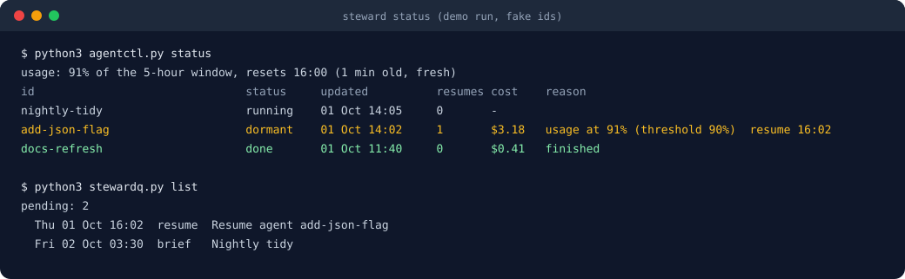
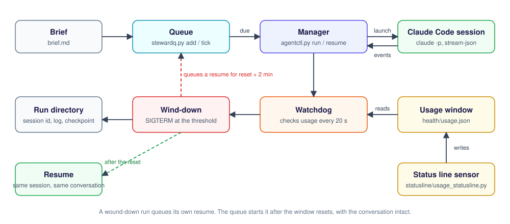
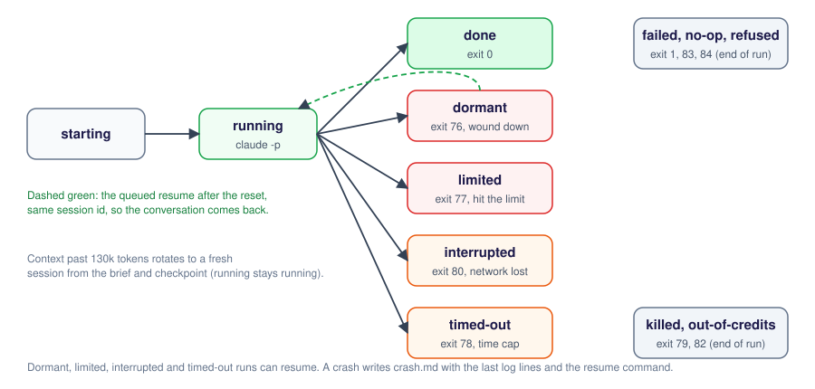

# Steward

[](https://github.com/cmills-dev/steward/releases/download/v0.2.0/steward-short-landscape.mp4)

**Two sessions, one unbroken conversation.**

[Download the portable preview](https://github.com/cmills-dev/steward/releases/tag/v0.2.0) · [Watch the short film](https://github.com/cmills-dev/steward/releases/download/v0.2.0/steward-short-landscape.mp4) · [Updates and feedback on X](https://x.com/CMills_Dev)

The v0.2.0 preview adds Claude Code, Codex and local-model adapters on Windows, macOS and Linux.
Same-provider resumes use a saved native conversation. Cross-provider or cross-machine handoffs start a fresh conversation from an exported checkpoint.
Project files and CLI authentication stay separate. Automatic context rotation, checkpoint nudges and model fallback remain Claude-only.
A real Codex task passed. Successful real local-model completion remains unverified.

The short film introduces the project. The longer social film illustrates a configured overnight run, rather than a live performance benchmark.

The documentation below covers the original Claude runner on the main branch. Use the preview's included README and installer for its portable commands.


[](LICENSE)
[](https://www.python.org/)
[](#requirements)
[](https://docs.claude.com/en/docs/claude-code)

**A managed runner for headless Claude Code agents. It winds a run down before the usage limit and resumes it after the reset, with the whole conversation intact.**



## The problem

`claude -p` is easy to start and easy to lose. Left alone overnight, an unattended run can:

- **Hit the usage limit** halfway through a task and stop, with nothing recording where it got to.
- **Crash or be cut off** when the laptop sleeps or the network drops, and leave you guessing what state the files are in.
- **Run unsupervised** for hours, re-sending an ever longer conversation on every turn, so the cost climbs with the square of the length, and with no cap on time or money.

Restarting from scratch wastes the work. Restarting blind repeats it.

## What Steward does

Every headless run goes through one manager, `agentctl.py`. It keeps the two things a clean restart needs: the session id, which brings the conversation back, and a five-part checkpoint (Done, In progress, Next, Files touched, How to verify) that the agent writes for a future self with no memory.

- **Wind-down before the limit.** At 90% of the five-hour usage window the run is stopped and a resume is queued for two minutes after the reset.
- **Resume with the conversation.** The resume reuses the session id and points the agent at its checkpoint.
- **Crash reports.** Any abnormal end writes `crash.md` with the exit code, the reason, the last log lines and the exact resume command.
- **A timed queue.** `stewardq.py` holds briefs and resumes with a start time each, and a one-minute tick starts what is due.
- **Caps and honest outcomes.** A time cap, a dollar ceiling, a cap on concurrent runs, and a distinct exit code for each way a run can end.

The detail of each is under [Features](#features).

## How it fits together



A brief enters the queue, the queue tick hands it to the manager, and the manager launches `claude -p` and records every event. A watchdog compares the usage window, written by the status line of any open interactive Claude Code session, with the threshold. Over the threshold, the run is stopped with its session id kept and a resume is queued for just after the reset. The queue starts that resume when it is due.

### The life of a run



## Quickstart

You need Python 3.9 or later and a clone. This path needs no Claude account and costs nothing, because it uses `examples/fake-claude`, a stand-in that emits the same events a real session would. The commands below were run from a clean clone on macOS.

```bash
git clone https://github.com/cmills-dev/steward.git && cd steward
export STEWARD_HOME="$(mktemp -d)" STEWARD_CLAUDE="$PWD/examples/fake-claude"
./setup.sh                                        # checks Python, runs the selftests
python3 agentctl.py run --id hello --brief examples/hello-brief.md
python3 agentctl.py status
```

```
agentctl selftest: 88/88 passed
stewardq selftest: 20/20 passed
statusline selftest: 4/4 passed
ALL PASS
agentctl: hello done: finished
usage: unknown (none); the watchdog cannot wind down on this, only react to a limit hit
id                               status     updated          resumes cost    reason
hello                            done       15 Oct 12:50     0       $0.01   finished
```

To run against the real thing, unset `STEWARD_CLAUDE` so `claude` on your PATH is used (it must be logged in), and run `STEWARD_LIVE=1 ./run_tests.sh` for one Haiku run that costs a few cents. For wind-down you also need the usage sensor, see [Setup](#setup).

### Watch a wind-down and resume

This uses the same stand-in, slowed down, and sets the usage reading by hand.

```bash
export DEMO_SLEEP=120
python3 agentctl.py usage --set 41 --resets "$(python3 -c 'import datetime as d;print((d.datetime.now().astimezone()+d.timedelta(hours=2)).isoformat(timespec="seconds"))')" > /dev/null
python3 agentctl.py run --id add-json-flag --brief examples/build-brief.md --model sonnet &
python3 agentctl.py usage --set 91 > /dev/null    # the watchdog notices within 20 seconds
```

```
agentctl: add-json-flag dormant: usage at 91% (threshold 90%)
$ python3 agentctl.py status
usage: 91% of the 5-hour window, resets 14:50 (0 min old, fresh)
id                               status     updated          resumes cost    reason
add-json-flag                    dormant    15 Oct 12:51     0       $0.01   usage at 91% (threshold 90%)  resume 14:52
$ python3 stewardq.py list
pending: 1
  Thu 15 Oct 14:52  resume  Resume agent add-json-flag
$ python3 agentctl.py resume add-json-flag        # the queue does this by itself at 14:52
agentctl: add-json-flag done: finished
```

The resume reuses the session id, so with the real CLI the agent picks up its own conversation.

## Usage

```bash
# Run a brief now, in the foreground, with its log streaming to runs/<id>/log.md
python3 agentctl.py run --id add-json-flag --brief examples/build-brief.md --model sonnet --max-minutes 60

# Or queue it for tonight (03:30), a time, or a delay
python3 stewardq.py add --at tonight --title "Add JSON flag" --file examples/build-brief.md
python3 stewardq.py add --at +2h --title "Add JSON flag" --file examples/build-brief.md
python3 stewardq.py list

# Every run, newest first, with the usage the watchdog sees
python3 agentctl.py status

# Follow one run's readable log
python3 agentctl.py logs add-json-flag --follow

# Everything about one run on one screen: state, checkpoint, last log lines, resume command
python3 agentctl.py report add-json-flag

# Wind a run down by hand, with its resume queued for 14:35
python3 agentctl.py pause add-json-flag --at 14:35

# Continue a dormant, limited or timed-out run with its conversation intact
python3 agentctl.py resume add-json-flag

# Stop a run for good, recording the outcome
python3 agentctl.py kill add-json-flag

# Archive finished runs older than 14 days and drop their raw streams
python3 agentctl.py gc
```

`agentctl.py report` prints one run on one screen. This is the real output of the demo run above, trimmed:

```
# hello
- status: done
- reason: finished
- resumes: 0
- cost_usd: 0.012
- session_id: ebce8763-5036-46c4-9808-1f289bba8438

## Checkpoint
## Done
- wrote steward-hello.txt
...
## Last log lines
12:50:34  session ebce8763-5036-46c4-9808-1f289bba8438 started, model demo, cwd None
12:50:34  says: Creating steward-hello.txt
12:50:34  END: success turns=2 cost=$0.012
```

The [examples](examples/) folder has three briefs: `hello-brief.md` (a smoke test), `build-brief.md` (a feature on a branch) and `nightly-tidy-brief.md` (an overnight chore to queue). A brief is plain Markdown. Name its repo on a line of its own, `**Repo: ~/code/my-project**`, and say what a finished report looks like.

## Features

- **Wind-down.** At 90% of the five-hour usage window the run is stopped and a resume is queued for two minutes after the reset. The threshold drops four points for each other run in flight, and never goes below 60%, because parallel runs spend the window fast. At 95% of the seven-day window running runs wind down too, and above 92% no new Opus or Sonnet run starts (Haiku runs still may).
- **Resume with the conversation.** A resume reuses the session id, so the agent gets its whole conversation back. The resume message points it at its checkpoint rather than a re-read of the tree.
- **Context rotation.** Past 130,000 tokens of context the session is ended at the next tool result, so no call is cut off, and a fresh session starts from the brief and the checkpoint alone. This happens at most four times per launch.
- **Liveness.** A run counts as alive if the manager's process, the session's process or a recent write to its log or checkpoint says so. Only a positive dead reading closes a run as orphaned, so a sandboxed status check never kills live work.
- **Nudge.** A run that writes no checkpoint for 20 minutes is stopped at its next tool result and resumed in place once with a message asking for the checkpoint.
- **Caps.** At most six managed runs at once, a 90-minute default time cap, and a $25 budget ceiling per launch (passed to `claude --max-budget-usd`). A flag file lifts the time caps while keeping the wind-down.
- **Honest outcomes.** Each ending has its own exit code: done, failed, dormant (wound down), limited, timed out, killed, interrupted (network), out of credits, no-op (finished without touching its checkpoint) and refused (the agent judged the brief out of scope). A network drop retries every five minutes for an hour. A model that is out of credits falls back down a model ladder.
- **Crash forensics.** Any abnormal end writes `crash.md` with the exit code, the reason, the last forty log lines, stderr, the checkpoint and the exact resume command.
- **A timed queue.** `stewardq.py` holds briefs and resumes with a time each. A tick, run every minute, starts what is due (resumes first, so a paused build finishes before new work starts) and defers anything the cap or the weekly ceiling would refuse.

## State on disk

All state lives under `STEWARD_HOME` (default `~/.steward`):

| Path | What it holds |
| --- | --- |
| `runs/<id>/brief.md` | The brief as launched |
| `runs/<id>/state.json` | Status, session id, pids, resumes, cost, resume time (written under a file lock) |
| `runs/<id>/stream.jsonl` | Every event the session emitted |
| `runs/<id>/log.md` | The readable log, written live |
| `runs/<id>/progress.md` | The agent's own checkpoint: Done, In progress, Next, Files touched, How to verify |
| `runs/<id>/notes.md` | Your notes for the run, quoted to the agent on its next resume or rotation |
| `runs/<id>/crash.md` | Written on any abnormal end |
| `health/usage.json` | The latest usage snapshot from the status line |
| `queue/pending/`, `queue/done/` | Queue entries before and after they start |

The code is three stdlib Python files: `agentctl.py` (the manager), `stewardq.py` (the queue) and `steward_config.py` (paths, clock and binary from environment variables), plus the status line sensor in `statusline/`.

## Requirements

- macOS or Linux. It was built and is used on macOS. On Linux everything works except the desktop notification and the launchd installer (use cron for the tick).
- Python 3.9 or later. No third-party packages.
- [Claude Code](https://docs.claude.com/en/docs/claude-code) installed and logged in, so `claude -p` works in a terminal.
- A Claude subscription for the wind-down. The usage percentages come from the status line document, which carries `rate_limits` for subscription accounts. Without them Steward still runs, caps and resumes, but can only react to a limit hit rather than wind down before it.

## Setup

1. Clone the repository.

   ```bash
   git clone https://github.com/cmills-dev/steward.git
   cd steward
   ```

2. Run the setup script. It checks Python and the `claude` CLI, creates `~/.steward` with `runs/`, `health/` and `queue/`, copies `.env.example` to `~/.steward/.env`, and runs the tests.

   ```bash
   ./setup.sh
   ```

3. Connect the usage sensor. Run `./setup.sh --statusline` to print the snippet, then add it to `~/.claude/settings.json`:

   ```json
   "statusLine": {
     "type": "command",
     "command": "python3 /path/to/steward/statusline/usage_statusline.py"
   }
   ```

   From then on any open interactive Claude Code session writes `~/.steward/health/usage.json` on every update. Check it with `python3 agentctl.py usage`.

4. Start the queue tick. On macOS, `./setup.sh --launchd` installs a launchd job that runs `stewardq.py tick` every 60 seconds. Elsewhere, add a cron line:

   ```
   * * * * * STEWARD_HOME=$HOME/.steward python3 /path/to/steward/stewardq.py tick
   ```

5. Optionally, install the `/agents` skill so an interactive Claude Code session knows how to drive Steward: `./setup.sh --skill`, then set `STEWARD_DIR` to the clone's path in your shell profile.

6. Try one real run. This spends a few cents on Haiku:

   ```bash
   STEWARD_LIVE=1 ./run_tests.sh
   ```

## Configuration

Settings are environment variables, read from your shell or from `~/.steward/.env`. Every value in `.env.example` is a placeholder or the default.

| Variable | Default | What it sets |
| --- | --- | --- |
| `STEWARD_HOME` | `~/.steward` | Where runs, health files and the queue live |
| `STEWARD_TZ` | the machine's zone | Time zone for timestamps |
| `STEWARD_CLAUDE` | `claude` on PATH | The Claude Code binary |
| `STEWARD_WORKDIR` | the current directory | The session's working directory when a run names no repo |
| `STEWARD_THRESHOLD` | 90 | Wind-down point, % of the five-hour window (also `health/threshold`) |
| `STEWARD_WEEKLY_WINDDOWN` | 95 | Wind-down point, % of the seven-day window |
| `STEWARD_WEEKLY_NO_NEW_RUNS` | 92 | Above this weekly %, no new non-Haiku run starts |
| `STEWARD_MAX_CONCURRENT` | 6 | Managed runs at once (also `{"slots": N}` in `health/capacity.json`) |
| `STEWARD_BUDGET_USD` | 25 | Dollar ceiling for one launch, 0 for none |
| `STEWARD_ROTATE_TOKENS` | 130000 | Context size that triggers a rotation |
| `STEWARD_NUDGE_MINUTES` | 20 | Minutes without a checkpoint write before the one nudge, 0 for off |
| `STEWARD_MODEL_LADDER` | Opus 5.5, Sonnet 5, Haiku 4.5 | Fallback models when one runs out of credits |
| `STEWARD_PERMISSION_MODE` | `bypassPermissions` | Permission mode for headless runs |
| `STEWARD_SETTINGS` | none | A Claude Code settings file (deny rules, hooks) for every run |
| `STEWARD_NOTIFY_CMD` | none | A command called with text, note and subject when a run needs a person |
| `STEWARD_STYLE_FILE` | `~/.steward/style.md` | Optional house style quoted into every prompt |
| `STEWARD_STRETCH_FILE` | `~/.steward/stretch.md` | Optional standing goal quoted into every prompt |

Three files in `~/.steward/health/` change behaviour without a restart. `threshold-override` holds one number that replaces the per-run wind-down point for every run. `no-time-limit`, while it exists, lifts the time caps. `capacity.json` sets the run cap.

A brief can name its own working directory on a line of its own: `**Repo: ~/code/my-project**`. `--repo` on the command line wins over it.

## FAQ

**Do I need a Claude subscription?** For the wind-down, yes. The usage percentages come from the status line document, which carries `rate_limits` for subscription accounts. Without them Steward still runs, caps and resumes, and reacts to a limit message by re-queuing the run for the reset.

**Does it work if I never open an interactive Claude Code session?** The sensor is the status line of an open interactive session. With none open the reading goes stale after 45 minutes and is ignored, and Steward falls back to reacting to the limit.

**Is it safe to leave running?** Runs use `bypassPermissions` by default because nobody is there to answer a prompt. Give each run a narrow brief and a working directory you are happy for it to change, and point `STEWARD_SETTINGS` at a settings file with deny rules. Nothing here pushes to git for you unless your brief says so.

**What does a run cost?** The cost is read from the session's result event and shown in `status`. `STEWARD_BUDGET_USD` (default 25) is passed to `claude --max-budget-usd` as a ceiling per launch.

**How do I try it without spending anything?** Use `examples/fake-claude`, as in the quickstart.

**Where did it stop?** `python3 agentctl.py report <id>`, and `runs/<id>/crash.md` if the run ended abnormally.

**Does it run on Linux?** Yes, except the desktop notification and the launchd installer. Use cron for the tick.

## Tests

```bash
./run_tests.sh
```

This runs the manager's selftest (88 checks), the queue's (20) and the status line sensor's (4) against a temporary `STEWARD_HOME`. None of them launches a session or needs the `claude` CLI. `STEWARD_LIVE=1 ./run_tests.sh` adds one real Haiku run of `examples/hello-brief.md`, and is skipped cleanly when `claude` is not installed.

## Limitations

- The wind-down depends on the status line. Claude Code writes the usage document only while an interactive session is open, so with none open the reading goes stale after 45 minutes and Steward falls back to reacting to a limit message, then re-queues the run for the reset.
- The usage fields and CLI flags it relies on (`rate_limits` in the status line document, `--max-budget-usd`, `--exclude-dynamic-system-prompt-sections`, `--disable-slash-commands`) belong to recent Claude Code versions and may change. Set `STEWARD_LEAN_FLAGS=0` if your version rejects the last two.
- Runs use `bypassPermissions` by default, because nobody is there to answer a prompt. Give each run a narrow brief and a working directory you are happy for it to change, and use `STEWARD_SETTINGS` for deny rules.
- Cost for a run that ends without a result event is an estimate from the stream's token counts at list prices, flagged `cost_estimated`.
- Rotation can cut off work in flight, such as a subagent's result or a long test run, so the checkpoint has to carry decisions, file paths and verify commands. The prompt tells the agent so.
- The desktop notification is macOS only, and `setup.sh --launchd` is macOS only.

## Roadmap

This repository is the core runner. The author's own, more evolved copy has features that are not in this repository yet and are not promised here:

- **Roles and standing orders.** A role (daily, coursework, build, git-reviewer) launches with its own settings file, a deny list, no MCP connectors and a pre-tool hook, so what a headless run may do is written in a file and enforced in code.
- **Git review of headless changes.** Ordinary headless runs cannot write to git. A run exports patches and asks, and a separate reviewer run checks them, then applies and commits them, stopping at a card for a person when a patch touches trusted files or contains a secret.
- **A fuller queue.** A queue helper and scheduled-work script with reasons and per-entry models.
- **The staged build pipeline.** One request becomes research, review, plan, build and ship runs chained by gates. That lives in [claude-build-pipeline](https://github.com/cmills-dev/claude-build-pipeline).

## Related

- [claude-build-pipeline](https://github.com/cmills-dev/claude-build-pipeline): the `/build` skill, which turns one request into a staged, supervised pipeline of headless runs. Steward is the runner underneath that kind of pipeline.
- [life-tracker-kit](https://github.com/cmills-dev/life-tracker-kit): a starter kit for a Claude Code life tracker, with a launchd scheduler and a timed work queue.
- [polaris-desk](https://github.com/cmills-dev/polaris-desk): a local desktop dashboard where AI agents hand work back to you as cards.

## Contributing

See [CONTRIBUTING.md](CONTRIBUTING.md).

## Licence

MIT. See [LICENSE](LICENSE).
